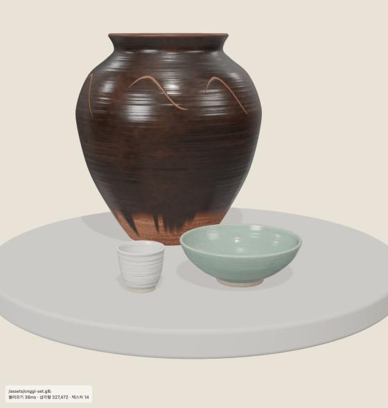
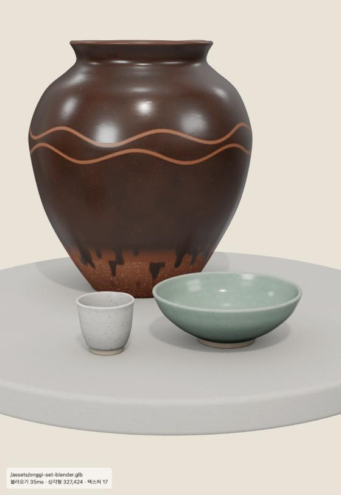

# web-trend-lab

Awwwards 수상작 렌더링 실측(2026-11-18 웹 트렌드 관찰)에서 본 기법을 직접 만든 에셋으로 다시 만들어 보는 개인 실험이다. 남의 사이트 디자인 · 문구 · 모델 · 유료 글꼴은 쓰지 않는다.

사이트: https://jaeho96.github.io/korean-ceramics/ (main 에 올리면 GitHub Actions 가 빌드해 Pages 에 배포한다, `.github/workflows/deploy.yml`)

2026-11-19부터 이 에셋으로 한국 도자기 소개 사이트 "흙으로 빚은 달"을 만든다. 계획과 진행 상태는 [docs/site-plan.md](docs/site-plan.md)에 있다. `npm run dev` 뒤 `/` 가 사이트, `/viewer.html` 이 에셋 확인용 뷰어다. 원본 glb · 구운 텍스처 · .blend 는 용량이 커서 저장소에 넣지 않았다. `assets-src/` 의 스크립트로 다시 만든다.



## 에셋 1: 도자기 세 점(가상의 공방 "Onggi")

옹기 항아리, 청자 사발, 백자 잔과 받침대다. 외부 에셋 없이 코드로만 만들었으므로 출처 표기나 라이선스 제약이 없다.

| 파일 | 크기 | 내용 |
|---|---|---|
| `assets-src/raw/onggi-set.raw.glb` | 11.5MB | PNG 텍스처, 압축 없음(비교용) |
| `public/assets/onggi-set.glb` | 1.6MB | Draco(edgebreaker, 위치 14비트) + WebP 텍스처(품질 85) |

정점 83,494개, 삼각형 164,736개, 텍스처 9장(항아리 2048px, 사발 · 잔 1024px)이다.

- 모양: `assets-src/build_models.mjs` 가 단면 윤곽(바깥 → 입술 → 안쪽)을 스플라인으로 그려 Three.js `LatheGeometry` 로 돌린다. 벽 두께가 있고 안쪽 면까지 있다.
- 텍스처: `assets-src/textures.py` 가 numpy 로 만든다. 가로(u)는 둘레라 FFT 주기 잡음으로 이음매가 없다. 세로(v)는 단면 윤곽의 길이 비율이다.
  - 항아리: 검붉은 잿물 유약, 굽 옆면에 드러난 흙과 흘러내린 유약, 어깨의 손가락 무늬(난초 무늬 흉내), 물레 자국.
  - 사발: 비색 유약, 두 크기의 빙렬(보로노이 경계), 안쪽 바닥과 굽 쪽에 고인 짙은 유약, 흙이 드러난 굽.
  - 잔: 푸른 기 도는 흰 유약, 철분 점, 뚜렷한 물레 자국.
- 텍스처 슬롯: basecolor(sRGB), orm(R=AO, G=거칠기, B=금속성), normal.

다시 만들기:

```bash
python3 assets-src/textures.py          # Python 3.11, numpy · Pillow
node assets-src/build_models.mjs        # glb 두 개
node assets-src/build_models.mjs --print-v   # 윤곽 제어점의 텍스처 v 값(텍스처 경계 맞출 때)
npm run dev                             # http://localhost:5179 (?raw 압축 없는 파일, ?still 회전 멈춤)
```

## 에셋 2: Blender 로 다시 만든 도자기 세트



같은 단면에서 시작해 Blender 5.3.0 을 화면 없이 Python 으로 돌려 만들었다(`assets-src/blender/build_set.py`). 이것도 외부 에셋 없이 만들었다. Blender 공식 매뉴얼은 GPL 이 Blender 프로그램에만 적용되고 만든 작품에는 적용되지 않는다고 적고 있다.

| 파일 | 크기 | 내용 |
|---|---|---|
| `assets-src/raw/onggi-set-blender.raw.glb` | 17.1MB | Blender glTF 내보내기 그대로(PNG) |
| `public/assets/onggi-set-blender.glb` | 991KB | 에셋 1과 같은 압축(`compress.mjs`, Draco + WebP 85) |
| `assets-src/blender/onggi-set.blend` | 3.0MB | 절차 재질이 남은 원본. Blender 에서 열어 고칠 수 있다 |

에셋 1과 다른 점은 이렇다.

- 모양: 둘레와 높이에 따라 반지름을 잡음만큼 바꾸고, 살짝 타원으로 만들고, 위로 갈수록 기울이고, 입술에 물결을 넣었다. 바깥면과 안쪽 면이 같이 움직여 벽 두께는 유지된다.
- 질감: 셰이더 노드로 만들고 Cycles 로 이미지에 구웠다. 물체 좌표 3D 잡음을 써서 UV 이음매나 바닥 가운데에 무늬가 몰리는 문제가 없다. 항아리의 흘러내린 유약은 높이 방향으로 거의 안 바뀌는 잡음, 어깨의 무늬는 사인 곡선 두 줄이다. 사발 빙렬은 보로노이 경계, 안쪽에 고인 유약은 국소 AO 로 만들었다.
- 그늘: AO 를 다른 물체까지 계산해 구웠다. 받침대에 물건이 닿은 자리의 그늘이 텍스처에 들어 있어 실시간 그림자 없이도 놓인 느낌이 난다. 받침대도 텍스처를 갖는다.
- 굽기 시간(M4 Pro, GPU Metal): 첫 실행 610초, 두 번째 실행 105초다. 첫 실행은 Cycles GPU 커널을 처음 컴파일하는 시간이 들어 있다. 같은 설정의 두 번째 실행에서 항아리가 567초에서 51초로 줄어 확인했다.

```bash
blender -b --factory-startup -P assets-src/blender/build_set.py -- "$PWD"
node assets-src/compress.mjs assets-src/raw/onggi-set-blender.raw.glb public/assets/onggi-set-blender.glb
```

뷰어에서는 `?set=blender` 로 연다.

## 외부 에셋 조달처(2026-11-18 확인)

이 사이트는 glb · 텍스처 · 글꼴 · 소리 파일이 브라우저로 그대로 내려가는 구조다. 그래서 "파일 자체가 공개돼도 되는가"를 기준으로 골랐다. 라이선스는 바뀌므로 쓰기 전에 원문을 다시 본다.

| 분류 | 바로 써도 되는 곳 | 조건이 붙는 곳 | 피할 곳 |
|---|---|---|---|
| 3D 모델 | Poly Haven(CC0), Kenney(CC0) | Quaternius(QAL, 작품에 넣는 건 되고 에셋만 재배포는 금지), Fab의 CC BY 항목(출처 표시) | Fab 표준 라이선스, CGTrader, TurboSquid 유료 모델(추출 방지 · 독점 형식 요구) |
| HDRI · 텍스처 | Poly Haven, ambientCG(둘 다 CC0) | | |
| 글꼴 | Google Fonts(대부분 OFL) | Fontshare 무료 서체(받은 파일 그대로만, 서브셋 · 형식 변환 금지), Pangram Pangram(체험판은 개인 사용, 웹에 올리려면 유료 웹 라이선스) | |
| 소리 | Freesound CC0 | Freesound CC BY(출처 표시), Pixabay(파일만 따로 주면 안 됨) | Freesound CC BY-NC |
| 모션 | LottieFiles 무료 애니메이션(Lottie Simple License) | Rive Marketplace(CC BY, 출처 표시) | |
| AI 생성 | | Meshy 무료 요금제(CC BY 4.0, 출처 표시) | |
| 직접 제작 | | Spline Free(웹 내보내기에 워터마크, 텍스처 있는 glTF 내보내기는 Pro부터) | |

- Quaternius 라이선스(QAL v1.0, 2026-08-28)와 Fontshare FFL v2.0(2026-08-17)은 원문을 직접 열어 확인했다. 나머지는 하위 에이전트가 각 공식 라이선스 페이지에서 확인한 내용이다.
- Fab · CGTrader · TurboSquid 를 피할 곳으로 둔 것은 해석이다. glb · Draco · KTX2 는 공개 형식이라 개발자 도구로 누구나 받아 다시 열 수 있어서, "최종 사용자가 추출할 수 없어야 한다"는 조건을 지키기 어렵다고 봤다.
- Fontshare 서체로 Three.js 3D 글자를 만들려면 typeface.json 이나 MSDF 로 바꿔야 하는데, 이것이 형식 변환에 걸린다. 3D 글자는 Google Fonts(OFL) 서체로 만든다.
- 미확인: Blender 라이선스 페이지(Cloudflare 확인 화면), Tripo 약관(403), Velvetyne 서체별 라이선스, Spline 약관과 AI 결과물 소유권, OFL 원문에서 형식을 바꾼 파일에 원래 서체 이름을 쓸 수 있는지(예약된 글꼴 이름 조항).

## 한계

- KTX2(Basis) 텍스처는 만들지 못했다. `toktx`(KTX-Software)가 이 맥에 없어서 WebP 로 대신했다. 수상작 실측에서는 KTX2(Basis) 로더 서명이 7곳에서 나왔다. WebP 는 내려받는 크기는 작지만 GPU 에서 압축이 풀린 채로 올라가 GPU 메모리를 KTX2 보다 많이 쓴다.
- 조명은 Three.js `RoomEnvironment` 로 만든 환경광이다. HDRI 파일은 쓰지 않았다.
- 에셋 1은 단면을 돌린 회전체뿐이다. 에셋 2는 찌그러짐과 기울어짐까지 넣었지만 손잡이처럼 붙이는 형태는 아직 없다.
- 두 세트 모두 사진처럼 보이는 질감이 아니라 절차적 질감이다. 가까이 보면 잡음 무늬가 드러난다.

## 다음

- 같은 `render_run.py`(`~/.claude/scripts/design-trends/render/`)로 이 페이지를 재서 수상작과 비교한다.
- 첫 로드 개선 실험: 3D 로드를 LCP 뒤로 미루기, 셰이더 미리 컴파일(`renderer.compileAsync`), 정지 이미지 먼저 보여 주기.
